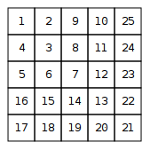

# Missing Number

## Problema
A number spiral is an infinite grid whose upper-left square has number 1. Here are the first five layers of the spiral:



On each move, you may increase the value of any element by one. What is the minimum number of moves required?

### Input

The first input line contains an integer t: the number of tests.

After this, there are t lines, each containing integers y and x.

## Pensamento

Observado que a diagonal principal segue uma PA de segunda ordem, podemos calcular os elementos da linha e coluna pedidos com base no elemento $a_{xx}$, prestando atenção se o indice X é par ou ímpar. 

## Resolução

```c
#include <stdio.h>

int main(void)
{
    long long t, x, y;
    scanf("%lld", &t);

    for (long long i = 0; i < t; i++)
    {
        scanf("%lld %lld", &x, &y);

        long long central;

        if (x > y)
        {
            central = 1 + x * (x - 1);
            if (x % 2 == 0)
            {
                printf("%lld\n", central + (x - y));
            }
            else
            {
                printf("%lld\n", central - (x - y));
            }
        }
        else if (x < y)
        {
            central = 1 + y * (y - 1);
            if (y % 2 == 0)
            {
                printf("%lld\n", central - (y - x));
            }
            else
            {
                printf("%lld\n", central + (y - x));
            }
        }
        else
        {
            central = 1 + y * (y - 1);
            printf("%lld\n", central);
        }
    }
}
```